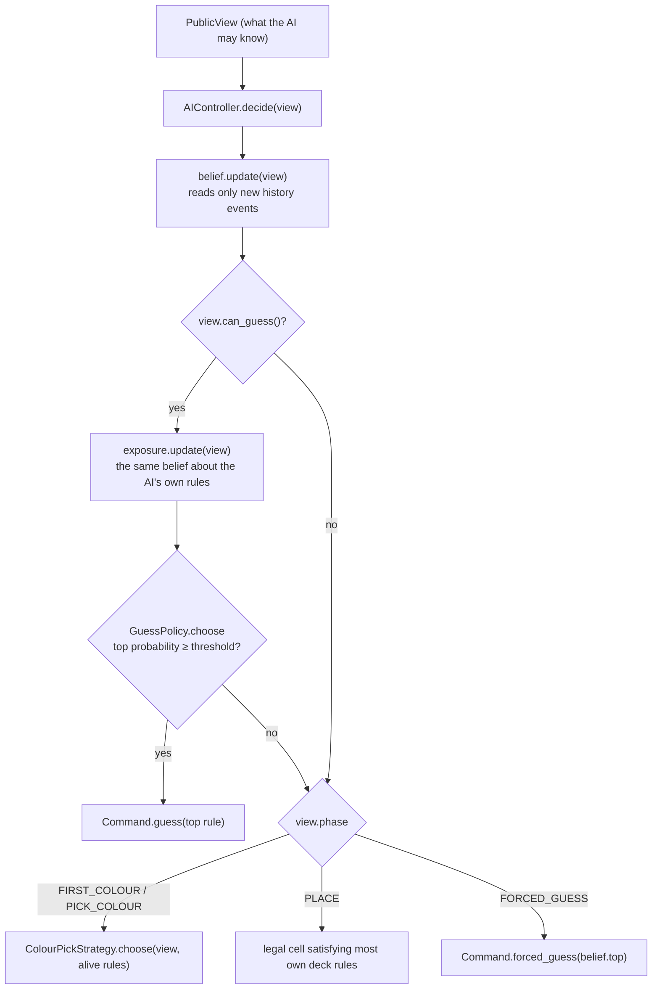

# Ballen AI internals

How the AI opponent works as built: what it reads, how it decides, the numbers it runs on, how they were measured,
and how to debug and check it. For the reasoning behind the design see
[ai-decision-theory-research.md](ai-decision-theory-research.md); for the plan of the remaining levels see issue #73.
Keep this document in step with `ai/`: every PR that changes the AI updates the sections it touches and the
[change log](#change-log).

## Contents

1. [Status by level](#status-by-level)
2. [Ground rules](#ground-rules)
3. [Architecture](#architecture)
4. [One decision, step by step](#one-decision-step-by-step)
5. [The belief](#the-belief)
6. [Guessing](#guessing)
7. [Colour picks](#colour-picks)
8. [Placement](#placement)
9. [Pauses and the driver](#pauses-and-the-driver)
10. [Parameters](#parameters)
11. [Measurements](#measurements)
12. [Debugging](#debugging)
13. [Quality checklist](#quality-checklist)
14. [Tests](#tests)
15. [Change log](#change-log)

## Status by level

| Level | Status | Built from |
| --- | --- | --- |
| Easy | Planned (#73): tempered belief, honest placement, loose colour picks, guesses at ~0.95 | — |
| Normal | Built | Belief with `normal_model()`, `DangerGuessPolicy`, `ColourPickStrategy` (uniform), max-k placement |
| Hard | Planned (#22, #73): joint honest/bluffing model, value-of-information colours, hiding utility, MCTS, expected-value guessing | — |

`AILevel.BUILT` lists the playable levels; the match setup screen shows the rest as "coming soon".

## Ground rules

These hold at every level. A change that breaks one is a bug, whatever it does to the win rate.

1. **The AI sees only a `PublicView`** (ADR 0002): board, history, both decks, its own secret rule. It never holds a
   reference to the `Match`, so it cannot read the opponent's secret rule or legal cells. Levels differ in how they
   *reason*, never in what they *see*.
2. **Every random choice goes through the injected `RandomNumberGenerator`.** The same seed gives the same match.
   That is what makes the harness numbers and the tests reproducible. A stray `randi()` or `randomize()` breaks it.
3. **The AI uses the engine's own rule checks** (`RuleChecker.legal_cells` / `is_legal`), judged on the position
   just before each event (`MatchPosition.before(i)`). It never re-implements a rule.
4. **The opponent's secret rule is never ruled out.** The hard evidence is certain, so the true rule always stays
   possible. If every rule ends up ruled out, the AI's view and the engine disagree (see [Debugging](#debugging)).
5. **The AI never names a rule the public moves have ruled out**, at any confidence.

## Architecture

| Class | File | Role |
| --- | --- | --- |
| `AIController` | `ai/ai_controller.gd` | A `Controller`: `decide(view) -> Command`. Holds the pieces below and the RNG. `for_level(level, rng)` builds a level's AI; `normal_model()` is Normal's model of the player |
| `Belief` | `ai/belief.gd` | A probability for each of the opponent's 5 rules (or, `about_viewer`, the AI's own) |
| `OpponentModel` | `ai/opponent_model.gd` | How the player is expected to choose among their legal cells: uniform. Holds `lapse` and `temper` |
| `HiderModel` | `ai/hider_model.gd` | An `OpponentModel` favouring cells many of the player's deck rules allow (`beta`) |
| `Deduction` | `ai/deduction.gd` | Hard elimination: the rules a player's placements and skips have ruled out. `candidates(view)`, `candidates_for(view, player)`, `rules_out(rule, before, event)` |
| `GuessPolicy` | `ai/guess_policy.gd` | When to name a rule: the top rule once its probability reaches `threshold(view, exposure)`; fixed threshold |
| `DangerGuessPolicy` | `ai/danger_guess_policy.gd` | Normal's guessing: threshold slides with how exposed the AI's own rule is |
| `ColourPickStrategy` | `ai/colour_pick_strategy.gd` | The colour handed to the opponent: highest expected number of candidates ruled out |
| `AILevel` | `ai/ai_level.gd` | The level enum, titles, descriptions, which are built |

Callers: the match scene (`main_game.gd`) builds the AI with `AIController.for_level(_setup.ai_level(), _rng)` and
runs it through `MatchDriver`; the harness (`harness/harness.gd`) builds `for_level(NORMAL, rng)` for both seats and
runs `Harness.play_out`.



## One decision, step by step

`AIController.decide(view)` is called whenever the match awaits the AI. It returns one `Command`, or `null` only for
a view that contradicts itself.

1. **Update the belief** with any history events it hasn't read (`Belief.update`). The alive rules feed the colour
   pick.
2. **Maybe guess.** If `view.can_guess()` (the AI's turn: before placing, after placing or skipping until its colour
   pick, or as the placer on a full board), update the exposure belief and ask the guess policy. If it returns a
   rule, the command is `guess(rule)`.
3. **Otherwise act on the phase:**
   - `FIRST_COLOUR`, `PICK_COLOUR`: pick the opponent's next colour (`ColourPickStrategy.choose`).
   - `PLACE`: place on a legal cell that satisfies the most of the AI's own 5 deck rules, ties at random.
   - `FORCED_GUESS` (full board, its sealed guess due): name the belief's top rule, ties at random. If no rule is
     left (impossible in a real match), it reports `"AIController: no candidate left for the forced guess"` and
     returns `null`.

A match calls `decide` many times per turn (once per command). The belief makes repeated calls cheap: only new
events are read.

## The belief

### What it holds

For each rule r of the deck it reasons about: `alive[r]` (the hard mask) and `log_score[r]` (the soft evidence).
`probabilities()` normalises the alive rules' scores with log-sum-exp (subtract the largest score before
exponentiating, so nothing overflows); a ruled-out rule has probability exactly 0. All probabilities sum to 1, unless
every rule is ruled out, when all are 0.

### Hard half (certain)

For each of the player's events in history, judged on `before = position.before(i)`, with `A_r` the cells rule r
allows for the event's colour (`RuleChecker.legal_cells(r, before, player, colour)`):

- **Placement on cell x:** every rule with x ∉ A_r is ruled out.
- **Skip:** every rule with A_r non-empty is ruled out (the player would have had a cell).

A ruled-out rule never comes back, whatever later evidence says. This is the same reasoning as
`Deduction.rules_out`, and the two must always agree.

### Soft half (a model of the player)

For a placement on x, each rule still alive gets

```
log_score[r] += temper × log P(x | r)
P(x | r) = (1 − lapse) × w(x) / Σ_{y ∈ A_r} w(y)  +  lapse / |A_r|
```

The weights w come from the `OpponentModel`, computed once per event from every deck rule's legal cells:

- **Uniform** (`OpponentModel`): w = 1 everywhere, so P(x | r) = 1/|A_r|. This is the *size principle*: a rule
  allowing fewer cells is favoured. Example (tested): on an empty board R04 "Never on the edge" allows 16 cells and
  a permissive rule 36, so an inner placement makes R04 36/16 = 2.25× as likely.
- **Hider** (`HiderModel`): w(x) = e^(β·k(x)), k(x) = how many of the player's 5 deck rules allow x. A player who
  hides favours cells most of their rules allow, so such a placement says less. In the same example the ratio drops
  to about 1.46.
- **Lapse** spreads part of every likelihood evenly over the legal cells, so the model can never all but rule out a
  rule the hard evidence keeps.
- **Temper** scales each placement's evidence. Below 1 the AI trusts its model less. Normal uses it to keep its
  confidence honest (see [Measurements](#measurements)); Easy will use a lower value to learn slowly.

Skips carry no soft evidence: they are forced, so only their hard half counts.

### Kept through a match

`AIController` keeps one `Belief` and calls `update(view)` on every decision. It reads events from `_seen` on and
remembers the last one read. It **starts afresh** when the view is not a continuation:

- the subject player changed, or
- the subject's deck rule ids differ, or
- the history is shorter than what it read, or
- the event at the last position read is not the same event (type, player, cell, colour, rule id).

That covers a new match, a rematch (new decks or new history), and a harness reusing an AI. A test checks that a
belief kept through a match always equals one built afresh from the same view.

### Exposure (the belief about the AI's own rules)

`Belief.new(model, true)` reasons about the *viewer's* deck from the viewer's own public moves, with the same model:
what an opponent reading the AI the way the AI reads them could believe. Its probability for the AI's secret rule is
how exposed the AI is. Normal's guessing uses it. (Hiding, #21, will use it to choose cells.)

### Other accessors

- `alive()`: the rules not ruled out, in deck order.
- `top(rng)`: the most likely rule; ties (within 1e-9) broken by the RNG; `null` if none is alive.
- `entropy()`: in bits, log₂5 ≈ 2.32 when fully hidden, 0 when certain. Not yet used in play; useful when debugging
  and for the planned post-match "AI's mind" view.

## Guessing

A guess ends the match: right wins, wrong loses. The policy decides when.

- **`GuessPolicy` (base):** names `belief.top()` when its probability ≥ the fixed threshold (−1e-9 tolerance).
  `GuessPolicy.new()` (threshold 1) guesses only when one rule is left; `GuessPolicy.new(INF)` never guesses. A
  ruled-out rule (probability 0) is never named.
- **`DangerGuessPolicy` (Normal):**

  ```
  threshold = lerp(SAFE 0.95, DESPERATE 0.35, danger)
  danger    = 1                                             if the AI has LOSING_SKIP − 1 skips
            = clamp((p_exposed − 0.2) / (0.95 − 0.2), 0, 1)  otherwise
  ```

  where p_exposed is the exposure belief's probability for the AI's own secret rule (0.2 = 1 in 5, nothing known).
  Example: the AI's own edge placement has shown it isn't R04, so p_exposed = 1/4. Then danger ≈ 0.067 and the
  threshold ≈ 0.91.
  The idea: while hidden, wait for near-certainty; as the opponent closes in, gamble on less, because waiting risks
  being named first.
- **Forced guess** (full board): always names `belief.top()`. Exactly one right guess wins, so the most likely rule is
  the best pick whatever the confidence.

Expected behaviour: in Normal-vs-Normal matches both sides become exposed and race, so about half the guesses are
wrong; against an AI that waits for certainty, Normal wins about 65%.

## Colour picks

`ColourPickStrategy.choose(view, candidates, rng)`: the colour with the highest `score()`, ties (within 1e-9) at
random. `score()` is the expected number of candidates (the belief's alive rules) ruled out by the opponent's next
turn in that colour. It assumes each candidate is equally likely and the opponent places uniformly among that
candidate's legal cells, or skips if there are none. Each candidate's legal cells are checked once on the position
the opponent will face (`next_turn(view, colour)`). With fewer than 2 candidates every colour scores 0, so the pick
is random; on the empty board it is random too.

Not yet using the belief's probabilities: #20 replaces it with expected information gain plus skip pressure.

## Placement

`AIController._best_cells(view)`: among `view.own_legal_cells()` (its secret rule's legal cells), the cells that
satisfy the most of its 5 deck rules, then a random one of them. A cell all 5 allow tells the opponent nothing. It
does not yet weigh mobility (keeping legal cells to avoid skips) or pressure; #21 adds those and the softmax over
which fake rule to break.

## Pauses and the driver

- **In the scene:** `MatchDriver` waits a random `MIN_PAUSE`–`MAX_PAUSE` (0.5–1.5 s) before each AI command, and holds
  the match while a skip is shown. The pause carries no information yet; #23 makes it scale with the decision.
- **In tests and the harness:** no pause. `Harness.play_out` asks the awaited players in turn and gives up (returns
  false) on a `null` command, a rejected command, or after `MAX_COMMANDS` (500).

## Parameters

| Parameter | Where | Value | How it was set |
| --- | --- | --- | --- |
| Normal β (hider strength) | `AIController.normal_model()` | 1.0 | Best-calibrated of 0.25 / 0.5 / 1.0 before tempering |
| Normal lapse ε | `normal_model()` | 0.2 | As above |
| Normal temper | `normal_model()` | 0.4 | Calibration sweep 0.6 / 0.4 / 0.25: 0.4 was closest to honest |
| `DangerGuessPolicy.SAFE` | `ai/danger_guess_policy.gd` | 0.95 | Research doc |
| `DangerGuessPolicy.DESPERATE` | same | 0.35 | Head-to-head sweep 0.35 / 0.5 / 0.6: 0.35 won most |
| `Belief.TIE`, `ColourPickStrategy.TIE` | | 1e-9 | Float tie tolerance |
| `MatchDriver.MIN_PAUSE` / `MAX_PAUSE` | `model/match_driver.gd` | 0.5 / 1.5 s | Milestone 1 |

Change a parameter only with a measurement: re-run the relevant measurement below and record the before and after
numbers in the PR and here.

## Measurements

All numbers are from seeded AI-vs-AI play on random decks, so they can be reproduced exactly.

### Calibration (is a rule held p likely right about p of the time?)

Every time an AI decided, its top rule's probability was bucketed and checked against the opponent's real secret
rule. 60 seeded matches, opponents playing Normal's max-k placement. Right / times seen:

| Model | 0.5–0.6 | 0.6–0.7 | 0.7–0.8 | 0.8–0.9 | 0.9–1 |
| --- | --- | --- | --- | --- | --- |
| Uniform | 106/256 (41%) | 118/266 (44%) | 132/257 (51%) | 160/310 (52%) | 1129/1531 (74%) |
| Hider β1 ε0.2, untempered | 119/316 (38%) | 146/291 (50%) | 128/284 (45%) | 219/342 (64%) | 971/1139 (85%) |
| Hider β1 ε0.2, temper 0.4 (Normal) | 188/429 (44%) | 198/350 (57%) | 127/174 (73%) | 59/79 (75%) | 741/751 (99%) |

(The 0.9–1 bucket includes certainty, a single rule left, which is always right.)

### Strength

| Match-up (200 seeded matches) | Result |
| --- | --- |
| Normal vs an AI guessing only when certain (uniform model), seats swapped | 130 – 66, 4 draws |
| Same, `DESPERATE` 0.5 | 120 – 73, 7 draws |
| Same, `DESPERATE` 0.6 | 116 – 77, 7 draws |
| Normal vs Normal, harness `--seed 1` | right guess 119, wrong guess 78, forced 3; 12.9 turns per match |
| Old (milestone 1) vs itself, harness `--seed 1` | right guess 188, wrong 0, third skip 2, forced 10; 16.8 turns |

Normal vs Normal with seeds 2 and 3: right/wrong 97/101 and 105/94. The mirror match is a race, so about half the
guesses are wrong; that is expected.

### Speed

Desktop, headless: 20 harness matches (≈ 360 AI decisions) in 9 s, about 25 ms per decision including the engine.
The belief costs at most 5 legal-cell checks per new opponent event.

### How to reproduce

- Mirror stats: `godot --headless --path . -s harness/run_harness.gd -- --matches 200 --seed 1`, after the import
  step.
- Head-to-head and calibration: a scratch `extends SceneTree` script in the project (see [Debugging](#debugging))
  that plays seeded matches with `Harness.play_out`, building one seat with `AIController.for_level(NORMAL, rng)` and
  the other with `AIController.new(rng, GuessPolicy.new(), ColourPickStrategy.new(), OpponentModel.new())`. For
  calibration, keep a `Belief` per seat, update it before each decision, and bucket `probability(top)` against
  `secret_rules[opponent]`. The guard test `test_reading_soft_evidence_beats_waiting_for_certainty` runs a 40-match
  version of the head-to-head.

## Debugging

### Reproduce a match

Every random choice comes from one seed. Reproduce a harness match by seed. The harness draws both decks, both
secret rules and the coin toss from `rng.seed = seed_value`, and the AIs share that RNG, so the same seed always
replays the same match. In a test, build the match and the AIs from `Fixtures.rng(seed)`, as `test/ai/*` does.

### Look inside a decision

Write a scratch script **inside the project** (e.g. `harness/zz_debug.gd`, deleted afterwards; scripts outside
`res://` can't resolve `class_name`s). Use `func _initialize()` and end with `quit()`; a script error leaves the
process running, so run it with `timeout`. Autoloads are not loaded with `-s`, so stay with `ai/`, `model/` and
`rules/` classes. Useful prints at each decision:

```gdscript
var belief: Belief = Belief.of(view, AIController.normal_model())
print(view.position.turn, " ", belief.probabilities(), " H=", belief.entropy())
var exposure: Belief = Belief.of(view, AIController.normal_model(), true)
print("exposed ", exposure.probability(view.own_secret_rule.id),
	" threshold ", DangerGuessPolicy.new().threshold(view, exposure))
print("alive (hard) ", Deduction.candidates(view).map(func(r: Rule) -> String: return r.id))
```

Run: `timeout 120 godot --headless --path . -s harness/zz_debug.gd`.

### Symptoms and where to look

| Symptom | Likely cause | Check |
| --- | --- | --- |
| The AI names a rule your moves ruled out | Hard mask broken, or `Belief` and `Deduction` disagree | `test_over_seeded_ai_matches_guesses_only_name_rules_still_possible`; compare `belief.alive()` with `Deduction.candidates(view)` |
| "no candidate left for the forced guess", or every probability 0 | The engine and the AI disagree on a rule (a rule reading history or rows differently), or a view edited in a test | Re-check the event with `RuleChecker.legal_cells(rule, position.before(i), player, colour)` against what the match accepted |
| The AI guesses early and often wrong | Overconfident soft evidence (temper too high, model too sharp) or danger too high | Calibration table above; print the exposure and the threshold |
| The AI never guesses until certain | Policy is the base `GuessPolicy` (e.g. a test passing `GuessPolicy.new()`), or `for_level` not used | How the controller was built |
| Same seed, different match | A random choice outside the injected RNG, or iteration over an unordered dictionary affecting a choice | Grep `ai/` for `randi`, `randf`, `randomize`, `shuffle` |
| A belief kept through a match differs from one built afresh | Continuation check missed a new history | `test_kept_through_a_match_it_matches_one_built_afresh`; `Belief._continues` |
| Slow turns | Too many legal-cell checks per decision | Count `RuleChecker` calls; the belief reads new events only, the colour pick checks each candidate on the next-turn position |

## Quality checklist

Before merging a change to `ai/`:

1. GUT suite passes at every commit (import step first).
2. Harness `--matches 20 --seed 1` exits 0 (no unfinished match), as CI runs it.
3. The ground rules hold: the `PublicView`-only tests, the never-names-a-ruled-out-rule test, determinism by seed.
4. A strength number before and after (200 seeded matches) in the PR: the new AI must not be weaker than the old at
   the same level, unless that is the point.
5. If the soft model or a parameter changed: the calibration table re-measured.
6. Decision time per AI move still well under 50 ms on desktop (Hard's search has its own budget).
7. This document, the technical design's AI section and, if levels change, the GDD's level table updated.
8. Once the level gates exist (#24): Hard beats Normal ≥ 60%, Normal beats Easy ≥ 65% over 1000+ seeded matches.

## Tests

| File | Covers |
| --- | --- |
| `test/ai/test_belief.gd` | Start uniform, size principle, hider and temper effects, hard mask permanence, top rule, kept = fresh, new match resets, exposure, contradictory view |
| `test/ai/test_guess_policy.gd` | Normal's threshold while hidden, exposed, one skip from losing; the base policy's fixed threshold and INF |
| `test/ai/test_ai_guess.gd` | Guess at the start of the turn and after placing with one rule left; not with two; a swapped policy; guesses only name live rules; Normal beats a certainty-only AI |
| `test/ai/test_ai_forced_guess.gd` | The forced guess on a full board, its seeded ties, the no-candidate report |
| `test/ai/test_deduction.gd` | Hard elimination by placements and skips on the position before each event |
| `test/ai/test_ai_colour_pick.gd` | The colour scores and the swappable strategy |
| `test/ai/test_ai_placement.gd` | Placement on max-k legal cells |
| `test/ai/test_ai_controller.gd` | Seeded determinism; two AIs playing a full scenario in code |
| `test/harness/*` | Harness determinism and stats |

## Change log

| PR | Change |
| --- | --- |
| Milestone 1 | Hard elimination only; guess with one rule left; uniform colour picks; max-k placement; random forced guess |
| #93 (#19) | `Belief` with soft evidence (`OpponentModel`, `HiderModel`, lapse, temper); exposure; `DangerGuessPolicy`; forced guess names the top rule; `AIController.for_level`; `Deduction.candidates_for` |
