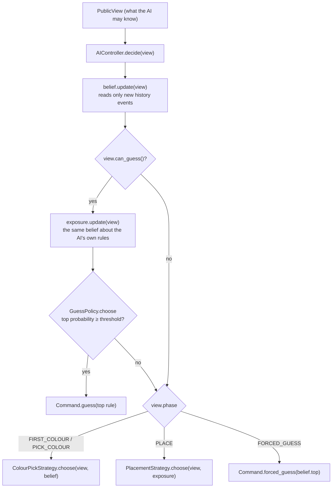

# Ballen AI internals

How the AI opponent works as built: what it reads, how it decides, the numbers it runs on, how they were measured,
and how to debug and check it. For the reasoning behind the design see
[ai-decision-theory-research.md](ai-decision-theory-research.md); for the plan of the remaining levels see issue #73.
Keep this document in step with `ai/`: every PR that changes the AI updates the sections it touches and the
[change log](#change-log).

## Contents

1. [Status by level](#status-by-level)
2. [Ground rules](#ground-rules)
3. [Architecture](#architecture)
4. [One decision, step by step](#one-decision-step-by-step)
5. [The belief](#the-belief)
6. [Guessing](#guessing)
7. [Colour picks](#colour-picks)
8. [Placement](#placement)
9. [Pauses and the driver](#pauses-and-the-driver)
10. [Parameters](#parameters)
11. [Measurements](#measurements)
12. [Debugging](#debugging)
13. [Quality checklist](#quality-checklist)
14. [Tests](#tests)
15. [Change log](#change-log)

## Status by level

| Level | Status | Built from |
| --- | --- | --- |
| Easy | Built | Belief with `easy_model()` (uniform, temper 0.15), `GuessPolicy(0.95)`, `LooseColourPick` (focus 0.4), `AnyLegalPlacement` |
| Normal | Built | Belief with `normal_model()`, `DangerGuessPolicy`, `InformationColourPick`, `HidingPlacement` |
| Hard | In progress (#22): pieces built, not yet playable (55% against Normal, gate 60%); tree search to come | Belief with `normal_model()`, `ValueGuessPolicy`, `SoftmaxColourPick`, `ExposurePlacement` |

`AILevel.BUILT` lists the playable levels; the match setup screen shows the rest as "coming soon". `for_level(HARD)`
already builds Hard, for the harness and tests, but it stays out of `BUILT` until it meets its gate.

## Ground rules

These hold at every level. A change that breaks one is a bug, whatever it does to the win rate.

1. **The AI sees only a `PublicView`** (ADR 0002): board, history, both decks, its own secret rule. It never holds a
   reference to the `Match`, so it cannot read the opponent's secret rule or legal cells. Levels differ in how they
   *reason*, never in what they *see*.
2. **Every random choice goes through the injected `RandomNumberGenerator`.** The same seed gives the same match.
   That is what makes the harness numbers and the tests reproducible. A stray `randi()` or `randomize()` breaks it.
3. **The AI uses the engine's own rule checks** (`RuleChecker.legal_cells` / `is_legal`), judged on the position
   just before each event (`MatchPosition.before(i)`). It never re-implements a rule.
4. **The opponent's secret rule is never ruled out.** The hard evidence is certain, so the true rule always stays
   possible. If every rule ends up ruled out, the AI's view and the engine disagree (see [Debugging](#debugging)).
5. **The AI never names a rule the public moves have ruled out**, at any confidence.

## Architecture

| Class | File | Role |
| --- | --- | --- |
| `AIController` | `ai/ai_controller.gd` | A `Controller`: `decide(view) -> Command`. Holds the pieces below and the RNG. `for_level(level, rng)` builds a level's AI; `normal_model()` is Normal's model of the player |
| `Belief` | `ai/belief.gd` | A probability for each of the opponent's 5 rules (or, `about_viewer`, the AI's own) |
| `OpponentModel` | `ai/opponent_model.gd` | How the player is expected to choose among their legal cells: uniform. Holds `lapse` and `temper` |
| `HiderModel` | `ai/hider_model.gd` | An `OpponentModel` favouring cells many of the player's deck rules allow (`beta`) |
| `Deduction` | `ai/deduction.gd` | Hard elimination: the rules a player's placements and skips have ruled out. `candidates(view)`, `candidates_for(view, player)`, `rules_out(rule, before, event)` |
| `GuessPolicy` | `ai/guess_policy.gd` | When to name a rule: the top rule once its probability reaches `threshold(view, exposure)`; fixed threshold |
| `DangerGuessPolicy` | `ai/danger_guess_policy.gd` | Normal's guessing: threshold slides with how exposed the AI's own rule is |
| `ColourPickStrategy` | `ai/colour_pick_strategy.gd` | Base colour pick: highest expected number of the belief's remaining rules ruled out, all equally likely. `best_of(scores, rng)` picks the top score, ties at random |
| `InformationColourPick` | `ai/information_colour_pick.gd` | Normal's colour pick: highest expected information gain about the opponent's rule, plus a skip bonus |
| `PlacementStrategy` | `ai/placement_strategy.gd` | Base placement: the legal cells most of its 5 deck rules allow, ties at random. `most_shared(view, rules)`, `pick(cells, rng)` |
| `HidingPlacement` | `ai/hiding_placement.gd` | Normal's placement: hide among the rules the opponent can still believe, then keep room for the next ball |
| `AnyLegalPlacement` | `ai/any_legal_placement.gd` | Easy's placement: any legal cell at random |
| `LooseColourPick` | `ai/loose_colour_pick.gd` | Easy's colour pick: the base strategy's pick with chance `focus`, otherwise any colour |
| `ValueGuessPolicy` | `ai/value_guess_policy.gd` | Hard's guessing: guess when its expected value beats waiting one more opponent turn |
| `SoftmaxColourPick` | `ai/softmax_colour_pick.gd` | Hard's colour pick: information-gain values, the colour drawn by softmax rather than always the best |
| `ExposurePlacement` | `ai/exposure_placement.gd` | Hard's placement: the cell after which the exposure belief holds the secret rule least likely |
| `AILevel` | `ai/ai_level.gd` | The level enum, titles, descriptions, which are built |

Callers: the match scene (`main_game.gd`) builds the AI with `AIController.for_level(_setup.ai_level(), _rng)` and
runs it through `MatchDriver`; the harness (`harness/harness.gd`) builds `for_level(NORMAL, rng)` for both seats and
runs `Harness.play_out`.



## One decision, step by step

`AIController.decide(view)` is called whenever the match awaits the AI. It returns one `Command`, or `null` only for
a view that contradicts itself.

1. **Update the belief and the exposure** with any history events they haven't read (`Belief.update`). The belief
   feeds the colour pick and the guess; the exposure feeds the guess and the placement.
2. **Maybe guess.** If `view.can_guess()` (the AI's turn: before placing, after placing or skipping until its colour
   pick, or as the placer on a full board), ask the guess policy. If it returns a
   rule, the command is `guess(rule)`.
3. **Otherwise act on the phase:**
   - `FIRST_COLOUR`, `PICK_COLOUR`: pick the opponent's next colour (`ColourPickStrategy.choose`).
   - `PLACE`: place where the placement strategy says (`PlacementStrategy.choose`; see [Placement](#placement)).
   - `FORCED_GUESS` (full board, its sealed guess due): name the belief's top rule, ties at random. If no rule is
     left (impossible in a real match), it reports `"AIController: no candidate left for the forced guess"` and
     returns `null`.

A match calls `decide` many times per turn (once per command). The belief makes repeated calls cheap: only new
events are read.

## The belief

### What it holds

For each rule r of the deck it reasons about: `alive[r]` (the hard mask) and `log_score[r]` (the soft evidence).
`probabilities()` normalises the alive rules' scores with log-sum-exp (subtract the largest score before
exponentiating, so nothing overflows); a ruled-out rule has probability exactly 0. All probabilities sum to 1, unless
every rule is ruled out, when all are 0.

### Hard half (certain)

For each of the player's events in history, judged on `before = position.before(i)`, with `A_r` the cells rule r
allows for the event's colour (`RuleChecker.legal_cells(r, before, player, colour)`):

- **Placement on cell x:** every rule with x ∉ A_r is ruled out.
- **Skip:** every rule with A_r non-empty is ruled out (the player would have had a cell).

A ruled-out rule never comes back, whatever later evidence says. This is the same reasoning as
`Deduction.rules_out`, and the two must always agree.

### Soft half (a model of the player)

For a placement on x, each rule still alive gets

```
log_score[r] += temper × log P(x | r)
P(x | r) = (1 − lapse) × w(x) / Σ_{y ∈ A_r} w(y)  +  lapse / |A_r|
```

The weights w come from the `OpponentModel`, computed once per event from every deck rule's legal cells:

- **Uniform** (`OpponentModel`): w = 1 everywhere, so P(x | r) = 1/|A_r|. This is the *size principle*: a rule
  allowing fewer cells is favoured. Example (tested): on an empty board R04 "Never on the edge" allows 16 cells and
  a permissive rule 36, so an inner placement makes R04 36/16 = 2.25× as likely.
- **Hider** (`HiderModel`): w(x) = e^(β·k(x)), k(x) = how many of the player's 5 deck rules allow x. A player who
  hides favours cells most of their rules allow, so such a placement says less. In the same example the ratio drops
  to about 1.46.
- **Lapse** spreads part of every likelihood evenly over the legal cells, so the model can never all but rule out a
  rule the hard evidence keeps.
- **Temper** scales each placement's evidence. Below 1 the AI trusts its model less. Normal uses it to keep its
  confidence honest (see [Measurements](#measurements)); Easy will use a lower value to learn slowly.

Skips carry no soft evidence: they are forced, so only their hard half counts.

### Kept through a match

`AIController` keeps one `Belief` and calls `update(view)` on every decision. It reads events from `_seen` on and
remembers the last one read. It **starts afresh** when the view is not a continuation:

- the subject player changed, or
- the subject's deck rule ids differ, or
- the history is shorter than what it read, or
- the event at the last position read is not the same event (type, player, cell, colour, rule id).

That covers a new match, a rematch (new decks or new history), and a harness reusing an AI. A test checks that a
belief kept through a match always equals one built afresh from the same view.

### Exposure (the belief about the AI's own rules)

`Belief.new(model, true)` reasons about the *viewer's* deck from the viewer's own public moves, with the same model:
what an opponent reading the AI the way the AI reads them could believe. Its probability for the AI's secret rule is
how exposed the AI is. Normal's guessing and placement use it.

### Other accessors

- `alive()`: the rules not ruled out, in deck order.
- `top(rng)`: the most likely rule; ties (within 1e-9) broken by the RNG; `null` if none is alive.
- `entropy()`: in bits, log₂5 ≈ 2.32 when fully hidden, 0 when certain. Not yet used in play; useful when debugging
  and for the planned post-match "AI's mind" view.

## Guessing

A guess ends the match: right wins, wrong loses. The policy decides when.

- **`GuessPolicy` (base):** names `belief.top()` when its probability ≥ the fixed threshold (−1e-9 tolerance).
  `GuessPolicy.new()` (threshold 1) guesses only when one rule is left; `GuessPolicy.new(INF)` never guesses. A
  ruled-out rule (probability 0) is never named. **Easy** uses it with `AIController.EASY_THRESHOLD` (0.95): it never
  gambles, even one skip from losing. With its slow-learning model it rarely reaches 0.95 before one rule is left.
- **`DangerGuessPolicy` (Normal):**

  ```
  threshold = lerp(SAFE 0.95, DESPERATE 0.35, danger)
  danger    = 1                                             if the AI has LOSING_SKIP − 1 skips
            = clamp((p_exposed − 0.2) / (0.95 − 0.2), 0, 1)  otherwise
  ```

  where p_exposed is the exposure belief's probability for the AI's own secret rule (0.2 = 1 in 5, nothing known).
  Example: the AI's own edge placement has shown it isn't R04, so p_exposed = 1/4. Then danger ≈ 0.067 and the
  threshold ≈ 0.91.
  The idea: while hidden, wait for near-certainty; as the opponent closes in, gamble on less, because waiting risks
  being named first.
- **`ValueGuessPolicy` (Hard):** pure expected value, no confidence floor. Count a win +1, a loss −1, a draw 0.
  Guessing the top rule now is worth `2p − 1`. Waiting one opponent turn is worth

  ```
  V_wait = −g·m + g·(1 − m) + (1 − g)·max(0, 2p' − 1)
  g  = clamp((their_top − 0.35) / (0.95 − 0.35), 0, 1)   chance the opponent guesses next turn
     = 1                                                if the AI is one skip from losing
  m  = exposure belief's probability for the AI's secret rule (at least 0.5 one skip from losing)
  p' = the top rule's probability one turn on: its odds p / (1 − p) multiplied by ODDS_PER_TURN (1.6)
  ```

  where their_top is the exposure belief's highest probability (how sure the opponent could be). The opponent
  names the AI's rule with chance g·m (the AI loses) or another rule with chance g·(1 − m) (the AI wins); otherwise
  the match goes on and the AI will be surer. It guesses once `2p − 1 ≥ V_wait`, that is `p ≥ (1 + V_wait) / 2`.
  Examples (tests): fully hidden with an even belief over 5 rules it holds back; with one rule left (p = 1) it
  guesses. `threshold()` reads the top probability recorded by the last `choose()`, so call `choose()` first.
  `choose()` and `threshold()` take the exposure belief, so a fake the AI broke (ruled out in the exposure)
  already counts as known to the opponent.
- **Forced guess** (full board): always names `belief.top()`. Exactly one right guess wins, so the most likely rule is
  the best pick whatever the confidence.

Expected behaviour: in Normal-vs-Normal matches both sides become exposed and race, so about half the guesses are
wrong; against an AI that waits for certainty, Normal wins about 65%.

## Colour picks

Every strategy's `choose(view, belief, rng)` returns the colour handed to the opponent; ties (within 1e-9) are
broken by the RNG (`ColourPickStrategy.best_of`). Each colour is judged on the position the opponent will face
(`ColourPickStrategy.next_turn(view, colour)`: the pick added to history, the turn advanced, the colour set).

### Normal: `InformationColourPick`

```
value(c) = H(b) − Σ_o P(o | c) · H(b'_o)   +   P(skip | c) · SKIP_BITS[opponent's skips]
```

- **Outcomes o:** a placement on any cell some alive rule allows, or a skip (a rule allowing no cell for c).
- **P(o | r)** comes from the AI's `OpponentModel` with its weights for that position (as in the belief):
  `likelihood(cell, A_r, weights)` for a placement, 1 for a skip when A_r is empty.
- **P(o | c) = Σ_r b(r) · P(o | r)**, with b the belief now.
- **The posterior b'_o** is updated the way the belief updates: b(r) · P(o | r)^temper, normalised. So the expected
  gain is measured in the same currency the belief will actually move by.
- **H** is entropy in bits; the first term is the expected information gain (never negative).
- **Skip bonus:** `SKIP_BITS` = [0.5, 1.0, 20.0] bits for a skip by an opponent with 0, 1 or 2 skips: a skip costs
  them a pip, and a third ends the match in the AI's favour, so with 2 skips a colour likely to force one wins out.

A colour every remaining rule treats alike is worth 0 (tested), so on the empty board picks are mostly ties broken
at random. Cost: 5 legal-cell checks per colour (20 per pick) plus the outcome loop.

### Hard: `SoftmaxColourPick`

The same values as `InformationColourPick`, but the colour is drawn with chance proportional to
`e^(precision · (v − v_best) / v_best)`, precision 6. A colour worth half the best is drawn e^−3 ≈ 1/20 as often as the
best. Always handing over the most telling colour would show an attentive player what the AI suspects; drawing
keeps that unreadable. When the best value is below `WORTH_WEIGHING` (nothing to weigh) it falls back to `best_of`.

### Base: `ColourPickStrategy`

`score()` is the expected number of the belief's alive rules ruled out by the opponent's next turn in that colour, if
each is equally likely and the opponent places uniformly among its legal cells or skips. Kept as the base class and
as the comparison point in measurements.

### Easy: `LooseColourPick`

With chance `focus` (0.4) the base strategy's considered pick, otherwise any of the 4 colours at random. A player
still sees it try, now and then, to hand them a colour that splits their rules.

## Placement

Every strategy's `choose(view, exposure, rng)` returns a cell among `view.own_legal_cells()` (its secret rule's legal
cells), or `NO_CELL` if there is none.

### Normal: `HidingPlacement`

1. **Hide among the believable rules.** Keep the legal cells allowed by the most of the AI's rules that its exposure
   belief still holds possible (`most_shared(view, exposure.alive())`). A cell all of them allow tells the opponent
   nothing. A fake the opponent has already ruled out no longer counts: breaking it again costs nothing, so it no
   longer keeps the AI off cells.
2. **Keep room.** Among those, keep the cells with the largest `room_after(view, cell)`: the fewest legal cells the
   AI's secret rule leaves it after placing there, over the 4 colours it could be handed next (the opponent's move in
   between is ignored). Fewer cells means a likelier skip.
3. Ties at random.

Cost: one legal check per own rule and legal cell, plus 4 legal-cell sweeps per cell tied after step 1.

### Hard: `ExposurePlacement`

1. **Least exposed.** For each legal cell, update a copy of the exposure belief as if the AI had placed there,
   exactly as the belief would (`exposed_after`: rules forbidding the cell drop out, the rest are weighted by
   their tempered likelihood under the AI's model), and keep the cells where the secret rule ends least likely
   (within 1e-6).
2. **Keep room**, as `HidingPlacement` step 2. Ties at random.

Unlike counting believable rules, this weighs *how* telling a cell is, and a fake already ruled out in the exposure
has probability 0, so it no longer constrains placement (test `test_after_breaking_a_fake_it_protects_the_others`:
once R04 is broken, Hard protects the remaining fakes instead). Still missing: choosing *which* fake to lose when a
break is forced, with later turns in mind; the tree search covers it.

### Easy: `AnyLegalPlacement`

Any cell its secret rule allows, at random: no attempt to keep its fakes believable, so its moves give its rule
away. That is what makes Easy readable for a new player.

### Base: `PlacementStrategy`

The legal cells most of all 5 deck rules allow, ties at random (milestone 1's behaviour).

## Pauses and the driver

- **In the scene:** after the AI decides, `MatchDriver` waits `controller.pause_seconds(rng)` before the command
  lands (with the driver's own RNG, so the AI's choices stay independent of it), and holds the match while a skip is
  shown. `Controller`'s default is a random 0.5–1.5 s.
- **The AI's pause** (`AIController.pause_seconds`) honestly tells how close its last decision was (GDD "Thinking
  time"):

  ```
  pause = lerp(0.5, 2.5, action closeness)                    colour pick or placement
        = max(that, lerp(0.5, 5.0, guess closeness))          if it weighed a guess
        ± 0.15 s wobble, clamped to 0.5–5 s
  ```

  - Colour closeness (`ColourPickStrategy.closeness`): runner-up score ÷ best score, 0 when the best is below 0.05
    (nothing to weigh, e.g. the empty board).
  - Placement closeness: a fixed 0.2 (routine), about 0.9 s.
  - Guess closeness (`GuessPolicy.last_closeness`): 1 − |p_top − threshold| ÷ 0.3, clamped; a guess made or held back
    right at the threshold pauses up to 5 s.

  On Easy and Normal this is a tell an attentive player can read (a long pause means unsure); Hard will add jitter so
  it carries none.
- **In tests and the harness:** no pause. `Harness.play_out` asks the awaited players in turn and gives up (returns
  false) on a `null` command, a rejected command, or after `MAX_COMMANDS` (500).

## Parameters

| Parameter | Where | Value | How it was set |
| --- | --- | --- | --- |
| Normal β (hider strength) | `AIController.normal_model()` | 1.0 | Best-calibrated of 0.25 / 0.5 / 1.0 before tempering |
| Normal lapse ε | `normal_model()` | 0.2 | As above |
| Normal temper | `normal_model()` | 0.4 | Calibration sweep 0.6 / 0.4 / 0.25: 0.4 was closest to honest |
| `DangerGuessPolicy.SAFE` | `ai/danger_guess_policy.gd` | 0.95 | Research doc |
| `DangerGuessPolicy.DESPERATE` | same | 0.35 | Head-to-head sweep 0.35 / 0.5 / 0.6: 0.35 won most |
| `HidingPlacement` worst-colour room | `ai/hiding_placement.gd` | min over 4 colours | Tiebreak only; a skip costs a pip whatever the colour |
| Easy temper | `AIController.easy_model()` | 0.15 (uniform model) | Learns slowly: each placement's evidence counts 0.15 (Normal's 0.4); an inner placement against R04 among 4 permissive rules moves it from 0.20 to about 0.22 |
| `AIController.EASY_THRESHOLD` | `ai/ai_controller.gd` | 0.95 | A fixed high threshold, no gambling |
| `LooseColourPick.focus` | `ai/loose_colour_pick.gd` | 0.4 | Considered picks some of the time, so it still looks like it tries |
| `InformationColourPick.SKIP_BITS` | `ai/information_colour_pick.gd` | 0.5 / 1.0 / 20.0 | Tried 1.5 / 3.0 / 20.0: identical results (forced skips are rare in AI play); the last value makes a winning skip dominate |
| `ValueGuessPolicy.SAFE` / `DESPERATE` | `ai/value_guess_policy.gd` | 0.95 / 0.35 | Normal's range, for the opponent's chance of guessing |
| `ValueGuessPolicy.ODDS_PER_TURN` | same | 1.6 | Sweep 1.15 / 1.3 / 1.6 / 2.5 against Normal: 105 / 105 / 109 / 109 wins of 200 |
| `SoftmaxColourPick.precision` | `ai/softmax_colour_pick.gd` | 6 | A colour worth half the best is drawn about 1 time in 20 |
| `ExposurePlacement.TIE` | `ai/exposure_placement.gd` | 1e-6 | Probability tie tolerance |
| `Belief.TIE`, `ColourPickStrategy.TIE` | | 1e-9 | Float tie tolerance |
| `Controller.MIN_PAUSE` / `MAX_PAUSE` | `model/controller.gd` | 0.5 / 1.5 s | Default pause (milestone 1) |
| `AIController.SHORTEST_PAUSE` / `ROUTINE_PAUSE` / `LONGEST_PAUSE` | `ai/ai_controller.gd` | 0.5 / 2.5 / 5.0 s | GDD: up to 5 s, longer on harder choices |
| `AIController.PLACEMENT_CLOSENESS`, `PAUSE_WOBBLE` | same | 0.2, ±0.15 s | Placements are routine; a little natural variation |
| `GuessPolicy.CLEAR_MARGIN` | `ai/guess_policy.gd` | 0.3 | A top rule 0.3 from the threshold is a clear call |
| `ColourPickStrategy.WORTH_WEIGHING` | `ai/colour_pick_strategy.gd` | 0.05 | Below this best score there is nothing to weigh |

Change a parameter only with a measurement: re-run the relevant measurement below and record the before and after
numbers in the PR and here.

## Measurements

All numbers are from seeded AI-vs-AI play on random decks, so they can be reproduced exactly.

### Calibration (is a rule held p likely right about p of the time?)

Every time an AI decided, its top rule's probability was bucketed and checked against the opponent's real secret
rule. 60 seeded matches, opponents playing Normal's max-k placement. Right / times seen:

| Model | 0.5–0.6 | 0.6–0.7 | 0.7–0.8 | 0.8–0.9 | 0.9–1 |
| --- | --- | --- | --- | --- | --- |
| Uniform | 106/256 (41%) | 118/266 (44%) | 132/257 (51%) | 160/310 (52%) | 1129/1531 (74%) |
| Hider β1 ε0.2, untempered | 119/316 (38%) | 146/291 (50%) | 128/284 (45%) | 219/342 (64%) | 971/1139 (85%) |
| Hider β1 ε0.2, temper 0.4 (Normal) | 188/429 (44%) | 198/350 (57%) | 127/174 (73%) | 59/79 (75%) | 741/751 (99%) |

(The 0.9–1 bucket includes certainty, a single rule left, which is always right.)

### Strength

| Match-up (200 seeded matches) | Result |
| --- | --- |
| Normal vs an AI guessing only when certain (uniform model), seats swapped | 130 – 66, 4 draws |
| Same, `DESPERATE` 0.5 | 120 – 73, 7 draws |
| Same, `DESPERATE` 0.6 | 116 – 77, 7 draws |
| Normal vs Normal, harness `--seed 1` | right guess 119, wrong guess 78, forced 3; 12.9 turns per match |
| Old (milestone 1) vs itself, harness `--seed 1` | right guess 188, wrong 0, third skip 2, forced 10; 16.8 turns |

Normal vs Normal with seeds 2 and 3: right/wrong 97/101 and 105/94. The mirror match is a race, so about half the
guesses are wrong; that is expected.

Colour picks (#20), 200 seeded matches, seats swapped, both sides Normal's belief and guessing:

| Normal's colour pick vs the base pick | Result |
| --- | --- |
| Information gain (as built) | 102 – 95, 3 draws |
| Information gain, `SKIP_BITS` 1.5 / 3.0 / 20.0 | 102 – 95, 3 draws (identical) |
| Expected rise of the top rule's probability instead of entropy | 104 – 94, 2 draws |

Within noise: between two Normals the guessing race decides most matches, and a better probe rarely changes who
guesses first. The information-gain pick stays (no weaker, principled, and the basis of Hard's blended pick).

Placement (#21), 200 seeded matches, seats swapped, both sides otherwise Normal:

| Normal's placement vs the base placement | Result |
| --- | --- |
| `HidingPlacement` (as built) | 118 – 80, 2 draws (60%) |

Of its 118 wins, 71 came from the opponent guessing wrong: better hiding makes the opponent's gambles fail.
Matches run a little longer (14.0 turns against 13.3).

Levels, 200 seeded matches, seats swapped:

| Match-up | Result | Gate |
| --- | --- | --- |
| Normal vs Easy | 181 – 19, 0 draws (90.5%); Normal's wins: 180 right guesses, 1 forced | Normal ≥ 65%: met |

Hard's pieces (#22), 200 seeded matches against Normal, seats swapped:

| Hard variant vs Normal | Hard's wins – Normal's |
| --- | --- |
| `ValueGuessPolicy` + `SoftmaxColourPick` + `ExposurePlacement` (as built) | 109 – 90 (55%) |
| Same, `ODDS_PER_TURN` 1.15 / 1.3 / 2.5 | 105 / 105 / 109 wins |
| Expected-value guessing alone, otherwise Normal | about 105 wins |
| A joint honest/bluffing `MixtureModel` belief in place of `normal_model()` | 89 – 109 (dropped) |

The heuristics alone don't reach the 60% gate; the one-turn lookahead in `value_of_waiting` is the part the tree
search will replace.

Easy almost never guesses first (its belief rarely reaches 0.95), so against people it is the opponent that gives its
rule away and leaves the guessing to them.

### Speed

Desktop, headless, 20 harness matches (`--seed 1`):

| Build | Time | Turns per match |
| --- | --- | --- |
| #19 belief, base colours and placement | 9.1 s | 17.8 |
| + information-gain colours (#20) | 11.3 s | 16.2 |
| + hiding placement (#21) | 20.3 s | 18.5 |

That is about 20 ms per decision on average, including the engine; placements are the heaviest. The belief costs at
most 5 legal-cell checks per new opponent event, a colour pick 20 sweeps, a placement up to 4 sweeps per tied cell.

### How to reproduce

- Mirror stats: `godot --headless --path . -s harness/run_harness.gd -- --matches 200 --seed 1`, after the import
  step. Level match-ups: add `--levels normal,easy` (seats swapped every other match; the summary's "Level wins"
  line), and `--gate 0.65` to fail below a share.
- Head-to-head and calibration: a scratch `extends SceneTree` script in the project (see [Debugging](#debugging))
  that plays seeded matches with `Harness.play_out`, building one seat with `AIController.for_level(NORMAL, rng)` and
  the other with `AIController.new(rng, GuessPolicy.new(), ColourPickStrategy.new(), OpponentModel.new())`. For
  calibration, keep a `Belief` per seat, update it before each decision, and bucket `probability(top)` against
  `secret_rules[opponent]`. The guard test `test_reading_soft_evidence_beats_waiting_for_certainty` runs a 40-match
  version of the head-to-head.

## Debugging

### Reproduce a match

Every random choice comes from one seed. Reproduce a harness match by seed. The harness draws both decks, both
secret rules and the coin toss from `rng.seed = seed_value`, and the AIs share that RNG, so the same seed always
replays the same match. In a test, build the match and the AIs from `Fixtures.rng(seed)`, as `test/ai/*` does.

### Look inside a decision

Write a scratch script **inside the project** (e.g. `harness/zz_debug.gd`, deleted afterwards; scripts outside
`res://` can't resolve `class_name`s). Use `func _initialize()` and end with `quit()`; a script error leaves the
process running, so run it with `timeout`. Autoloads are not loaded with `-s`, so stay with `ai/`, `model/` and
`rules/` classes. Useful prints at each decision:

```gdscript
var belief: Belief = Belief.of(view, AIController.normal_model())
print(view.position.turn, " ", belief.probabilities(), " H=", belief.entropy())
var exposure: Belief = Belief.of(view, AIController.normal_model(), true)
print("exposed ", exposure.probability(view.own_secret_rule.id),
	" threshold ", DangerGuessPolicy.new().threshold(view, exposure))
print("alive (hard) ", Deduction.candidates(view).map(func(r: Rule) -> String: return r.id))
```

Run: `timeout 120 godot --headless --path . -s harness/zz_debug.gd`.

### Symptoms and where to look

| Symptom | Likely cause | Check |
| --- | --- | --- |
| The AI names a rule your moves ruled out | Hard mask broken, or `Belief` and `Deduction` disagree | `test_over_seeded_ai_matches_guesses_only_name_rules_still_possible`; compare `belief.alive()` with `Deduction.candidates(view)` |
| "no candidate left for the forced guess", or every probability 0 | The engine and the AI disagree on a rule (a rule reading history or rows differently), or a view edited in a test | Re-check the event with `RuleChecker.legal_cells(rule, position.before(i), player, colour)` against what the match accepted |
| The AI guesses early and often wrong | Overconfident soft evidence (temper too high, model too sharp) or danger too high | Calibration table above; print the exposure and the threshold |
| The AI never guesses until certain | Policy is the base `GuessPolicy` (e.g. a test passing `GuessPolicy.new()`), or `for_level` not used | How the controller was built |
| Same seed, different match | A random choice outside the injected RNG, or iteration over an unordered dictionary affecting a choice | Grep `ai/` for `randi`, `randf`, `randomize`, `shuffle` |
| A belief kept through a match differs from one built afresh | Continuation check missed a new history | `test_kept_through_a_match_it_matches_one_built_afresh`; `Belief._continues` |
| Slow turns | Too many legal-cell checks per decision | Count `RuleChecker` calls; the belief reads new events only, the colour pick checks each candidate on the next-turn position |

## Quality checklist

Before merging a change to `ai/`:

1. GUT suite passes at every commit (import step first).
2. Harness `--matches 20 --seed 1` exits 0 (no unfinished match), as CI runs it.
3. The ground rules hold: the `PublicView`-only tests, the never-names-a-ruled-out-rule test, determinism by seed.
4. A strength number before and after (200 seeded matches) in the PR: the new AI must not be weaker than the old at
   the same level, unless that is the point.
5. If the soft model or a parameter changed: the calibration table re-measured.
6. Decision time per AI move still well under 50 ms on desktop (Hard's search has its own budget).
7. This document, the technical design's AI section and, if levels change, the GDD's level table updated.
8. The level gates hold over 1000 seeded matches (the nightly "AI gates" workflow, or locally
   `godot --headless --path . -s harness/run_harness.gd -- --matches 1000 --seed 1 --levels normal,easy --gate 0.65`):
   Normal beats Easy ≥ 65%; once Hard exists, Hard beats Normal ≥ 60%.

## Tests

| File | Covers |
| --- | --- |
| `test/ai/test_belief.gd` | Start uniform, size principle, hider and temper effects, hard mask permanence, top rule, kept = fresh, new match resets, exposure, contradictory view |
| `test/ai/test_guess_policy.gd` | Normal's threshold while hidden, exposed, one skip from losing; the base policy's fixed threshold and INF |
| `test/ai/test_ai_guess.gd` | Guess at the start of the turn and after placing with one rule left; not with two; a swapped policy; guesses only name live rules; Normal beats a certainty-only AI |
| `test/ai/test_ai_forced_guess.gd` | The forced guess on a full board, its seeded ties, the no-candidate report |
| `test/ai/test_deduction.gd` | Hard elimination by placements and skips on the position before each event |
| `test/ai/test_ai_colour_pick.gd` | The base colour scores and the swappable strategy |
| `test/ai/test_information_colour_pick.gd` | A colour all rules treat alike is worth 0; the telling colour is picked; the skip bonus grows with the opponent's skips; a ruled-out rule no longer counts |
| `test/ai/test_ai_placement.gd` | Placement on max-k legal cells (through the controller) |
| `test/ai/test_easy_level.gd` | Easy is built; places anywhere legal (gives R04 away); learns more slowly than Normal; loose colour picks; never gambles; Normal beats it clearly over 30 seeded matches |
| `test/ai/test_ai_pause.gd` | A clear decision pauses briefly; a guess held back at its threshold pauses longer than any routine move; pauses stay within 0.5–5 s |
| `test/model/test_match_driver.gd` | The driver asks each paused controller for its pause after deciding; skip displays |
| `test/ai/test_hiding_placement.gd` | Hides off cells a believable fake forbids; once that fake is ruled out its cells are free again; `room_after` takes the worst colour; ties go to the most room |
| `test/ai/test_hard_pieces.gd` | Waiting worth more than an unsure guess while hidden, little one skip from losing; holds back on an even belief, guesses with one rule left; protects the other fakes after breaking one; softmax draws every colour at precision 0; exposure placement keeps R04 believable; Hard not in `BUILT` yet |
| `test/ai/test_ai_controller.gd` | Seeded determinism; two AIs playing a full scenario in code |
| `test/harness/*` | Harness determinism and stats |

## Change log

| PR | Change |
| --- | --- |
| Milestone 1 | Hard elimination only; guess with one rule left; uniform colour picks; max-k placement; random forced guess |
| #93 (#19) | `Belief` with soft evidence (`OpponentModel`, `HiderModel`, lapse, temper); exposure; `DangerGuessPolicy`; forced guess names the top rule; `AIController.for_level`; `Deduction.candidates_for` |
| #20 | Colour strategies take the belief; Normal picks by `InformationColourPick` (expected information gain plus skip bonus) |
| #21 | Placement is a `PlacementStrategy`; Normal places by `HidingPlacement` (believable rules only, then room); the exposure belief is updated every decision |
| #23 | The controller chooses its pause (`Controller.pause_seconds`), after its decision; the AI's grows with how close the decision was |
| Easy | `AILevel.BUILT` gains Easy: `easy_model()`, `GuessPolicy(0.95)`, `LooseColourPick`, `AnyLegalPlacement` |
| #24 | Harness `--levels` and `--gate`; CI smoke-runs Normal vs Easy; `ai-gates.yml` runs the gates nightly |
| #22 (part) | Hard's pieces: `ValueGuessPolicy`, `SoftmaxColourPick`, `ExposurePlacement`, `for_level(HARD)`; not yet in `BUILT` |
