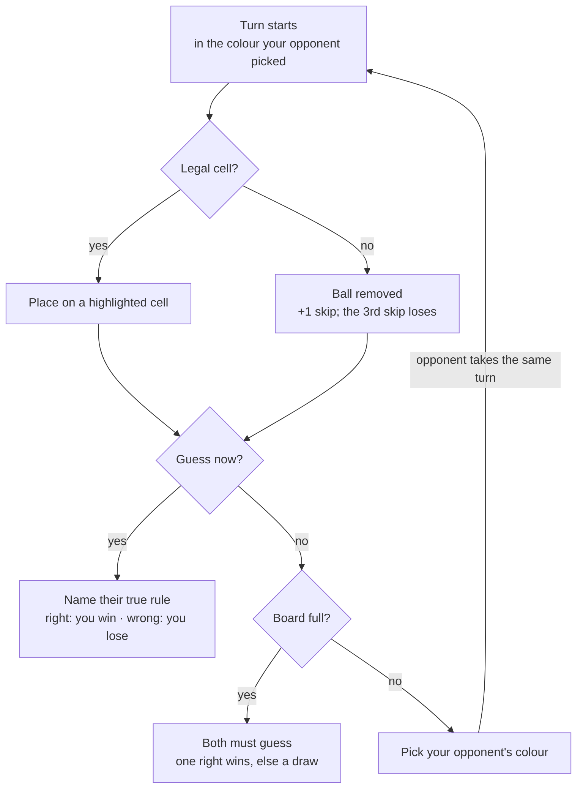

# Ballen — Game Design Document

Oct 25, 2026 · Cezary Troska

> Exported from the online design doc. When the design changes, update this file (or re-export) so the repo copy stays the reference for code.

This document covers **what** Ballen is and **why**. Detail lives in companion docs: [Technical design](technical-design.md) · [Rules library](rules-library.md) · [AI research](ai-decision-theory-research.md).

## 1. Game overview

Ballen is a two-player bluffing and deduction game on a 6 × 6 board. Each player hides one true rule among four fakes, places balls to bluff, and wins by naming which of the opponent's rules is real. Anything marked *Open question* still needs a decision.

| Field | Current answer |
| --- | --- |
| Title | Ballen |
| Elevator pitch | Hide your one true rule among four fakes, bluff with every ball you place, and win by naming your opponent's real rule first. |
| Genre | Two-player bluffing and deduction / abstract strategy |
| Players | 1 player vs. AI (Easy, Normal, Hard) at launch; online matchmaking in a later release |
| Platform | Browser first (web build, e.g. on itch.io), then mobile (Android, iOS). Mouse and touch. |
| Engine | Godot 4.7, GDScript |
| Target audience | *Open question: e.g. fans of deduction games like Cryptid and Zendo, mobile puzzle players.* |
| Match length | *Open question: target minutes per match.* |
| Unique selling point | Rules hidden in plain sight: you see all 5 of your opponent's rules and race to work out which one is real, while your own true rule limits what you can do. |

## 2. Gameplay & mechanics

A match is a duel of hidden rules. Each player's one true rule decides where they may place; their four fakes exist only to mislead. You win by naming your opponent's true rule, or when they skip 3 times.

Hiding is the obvious strategy: placing only where all 5 of your rules hold reveals nothing. The colour pick is the counter: every colour you hand your opponent is a probe that can force a fake rule to break, or force a skip.

| Element | How it works |
| --- | --- |
| Setup | Each player brings a saved deck of 5 rules and secretly marks 1 as true for this match. The opponent sees all 5, not which one is true. |
| Board | 6 × 6 grid shared by both players. Rules look at the whole board, both players' balls included. |
| Balls | 4 colours: yellow, blue, red, green. Your opponent picks the colour you place next; the match's first ball is random. |
| Placing | Cells legal under your true rule are highlighted, and you must place if any is legal. Fake rules are never enforced. A drop on any other cell snaps back, unseen by the opponent. |
| Skip | No legal cell for that colour: the game removes the ball automatically. 3 skips in total and you lose. |
| Guess | After placing or skipping, you may name your opponent's true rule. Right wins, wrong loses (may become 2 wrong guesses after playtesting). |
| Full board | Both players must guess. Exactly one right wins; both right or both wrong is a draw. |
| Notes | Mark opponent rules ✗ ruled out or ? suspect. Private, never checked by the game. |
| History | Step back through every past board state, with each turn's ball or skipped colour highlighted. |

**Open questions**

- [ ] Who takes the first turn, and does going first need balancing?
- [ ] Ratio of true to fake rules: keep 1 / 4, or try 2 / 6? (playtest)
- [ ] Wrong guesses before losing: 1 or 2? (playtest)
- [ ] Does the colour pick need limits, e.g. not the same colour twice in a row? (playtest)
- [ ] With 2 true rules, must a guess name both?
- [ ] Turn time limit for online play?

## 3. Progression & content

The rules library is Ballen's main content. Every rule is plain data assembled from shared parts, so a new rule needs no code, and a new mechanic is one new part that leaves existing rules untouched.

**How rules work.** Every rule is a fill-in-the-blank sentence, such as "Ball can't be placed in the same \_\_\_ as \_\_\_", so built-in and player-made rules look and read the same. Rules can look at colours, neighbours, position, counts, ball owner, placement history, turn number and skips. How the engine builds and checks them is in the [technical design](technical-design.md#rules-engine).

**Examples:** never next to the same colour; only on even rows; not next to the ball you placed last; after any skip, must touch one of your own balls. The full catalogue, with each rule's status and strictness, is the [rules library](rules-library.md).

**Decks and player-made rules**

- A deck is 5 rules, saved and reused; the true rule is chosen at the start of each match.
- All built-in rules are available at launch; unlocking rules may become the progression system later.
- Player-made rules come in a later release: fill-in-the-blank templates with dropdowns. A strictness check tests each new rule on many random boards and accepts it only if it forbids roughly 20–60% of placements (thresholds set in playtesting).

**Open questions**

- [ ] Progression: what do players earn (rules, cosmetics, ranks)?
- [ ] Modes beyond single matches vs. AI, e.g. a puzzle campaign?

## 4. Story, setting & tone

Ballen is currently an abstract game with no story, which is normal for the genre. Decide early whether it stays that way, because the answer shapes art and audio.

- [ ] Pure abstract, or a light theme (e.g. a character, a world, a framing device)?
- [ ] Tone in three words (e.g. calm, clever, playful)

## 5. Interface & controls

Ballen is played by drag and drop with mouse or touch. On your turn the cells your true rule allows are highlighted, so nobody has to work out legality in their head; a drop anywhere else snaps the ball back.

| Screen | Contents | Status |
| --- | --- | --- |
| Main menu | Single Player, Quit; later Online and Deck builder | Built (`gui/menus/main_menu.tscn`) |
| Deck builder | Choose 5 rules from the library and save decks; later the template editor for player-made rules | Not started |
| Match setup | Pick a deck, mark its true rule, choose AI level (Easy, Normal, Hard) | Not started |
| Game screen | Board, your ball, colour picker for the opponent's next ball, both rule lists, skip counters, Guess button | In progress (`main_game.tscn`, `gui/rules_box.tscn`) |
| Notes | Tap an opponent rule to cycle ✗ ruled out / ? suspect / no mark | Not started |
| History | Step back and forward through board states; each turn's ball or skipped colour highlighted | Not started |
| Pause / settings | *Open question* | Not started |
| Match end | Win, lose or draw. *Open question: reveal both true rules, rematch button?* | Not started |

**Layout:** portrait window, 512 × 704 px, which suits both phones and the browser. The 6 × 6 board sits between the opponent's area at the top and yours at the bottom.

- [ ] Where do both rule lists, notes and history fit on a phone screen?
- [ ] Feedback for placing, skipping and guessing (animation, sound)?
- [ ] How does the opponent see that you skipped, and which colour it was?

## 6. Art & audio

Art uses Kenney assets for now, with one ball sprite tinted at runtime to yellow, blue, red or green. Audio has not been started.

| Asset group | Needed | Status |
| --- | --- | --- |
| Balls | One sprite, 4 colour tints | Done (Kenney + `Constants.colors`) |
| Board | Tile set for the grid | In use (Kenney) |
| UI / menus | Buttons, rule cards, fonts | Partly done |
| Effects | Legal-cell highlight; place, skip, guess and win feedback | Not started |
| Sound effects | Pick up, place, skip, guess, turn change | Not started |
| Music | Menu and in-game tracks | Not started |

- [ ] Keep the Kenney look, or move to custom art later?
- [ ] Colour-blind support: add a shape or pattern per ball colour?

## 7. Technical overview

Ballen runs on Godot 4.7 with the GL Compatibility renderer and statically typed GDScript, which exports to the browser first and to Android and iOS later. Game logic is kept apart from the scenes, so the AI, the highlights and a future server all run the same code.

The AI sees only what a human opponent could see, and online play (later) runs on a server so no client ever receives the opponent's true rule. Architecture, the rules engine and the AI implementation are in the [technical design](technical-design.md).

## 8. Production

The next milestone is a playable prototype: one full match against a simple AI, with rules built from parts. Dates are not set yet; add them when you know your weekly time budget.

1. **Prototype** — game model and rules engine, a handful of rules, highlights, colour picks, skips, guessing, a simple AI, match result
2. **Rules & decks** — a larger rule library, deck builder and match setup screens
3. **AI levels** — Easy, Normal, Hard, each deducing and bluffing fairly
4. **Vertical slice** — notes, history, feedback effects, sound, match-end screen
5. **Browser release** — web build for playtesting (e.g. itch.io); tune rule ratio, wrong guesses and colour picks
6. **Mobile release** — Android and iOS builds, touch polish
7. **Later** — online matchmaking, player-made rules, rule unlocks

**Out of scope for the first release:** online multiplayer and player-made rules (both planned later), story, monetisation. *Open question: confirm story and monetisation.*
