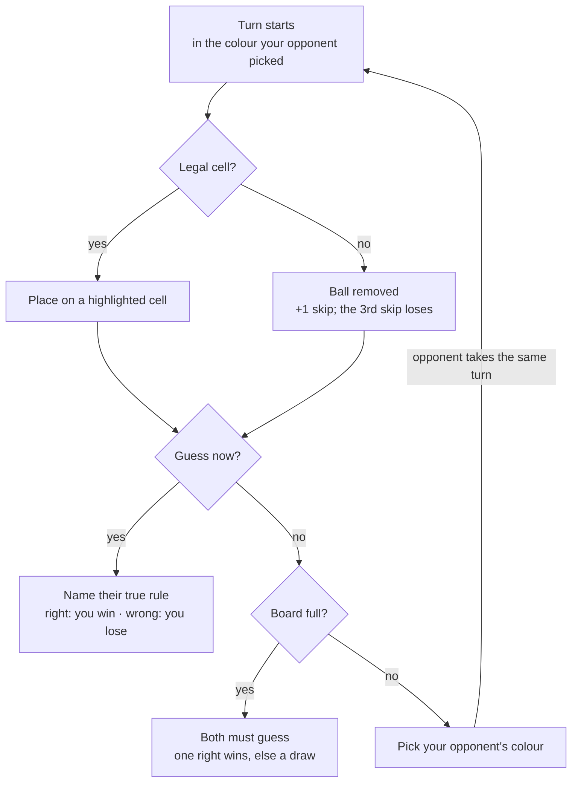
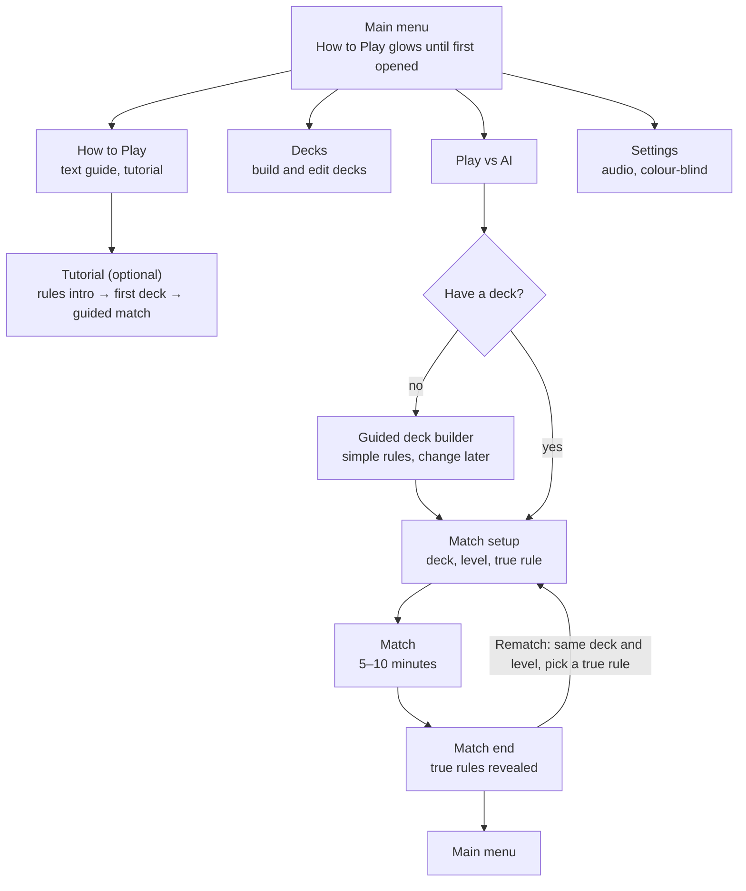

# Ballen — Game Design Document

Oct 25, 2026 · Cezary Troska

> Exported from the online design doc. When the design changes, update this file (or re-export) so the repo copy stays the reference for code.

This document covers **what** Ballen is and **why**. Detail lives in companion docs: [Technical design](technical-design.md) · [Rules library](rules-library.md) · [AI research](ai-decision-theory-research.md).

## 1. Game overview

Ballen is a two-player hidden-information duel on a 6 × 6 board. Each player hides one true rule among four fakes, places balls that give away as little as possible, and wins by naming which of the opponent's rules is real. Anything marked *Open question* still needs a decision.

| Field | Current answer |
| --- | --- |
| Title | Ballen |
| Elevator pitch | Hide your one true rule among four fakes, give little away with every ball you place, and win by naming your opponent's real rule first. |
| Genre | Two-player hidden-information duel / abstract strategy |
| Players | 1 player vs. AI (Easy, Normal, Hard) at launch; online matchmaking in a later release |
| Platform | Browser first (web build, e.g. on itch.io), then mobile (Android, iOS). Mouse and touch. |
| Engine | Godot 4.7, GDScript |
| Target audience | Deduction fans, 16+, who want a tense 5–10 minute match on phone or browser |
| Match length | 5–10 minutes against the AI |
| Unique selling point | Rules hidden in plain sight: you see all 5 of your opponent's rules and race to work out which one is real, while your own true rule limits what you can do. |

### Design pillars

Every design decision is checked against these four.

1. **Outsmart, don't outluck.** Wins come from reading the opponent's moves and hiding your own, not from lucky colours.
2. **Fair hidden information.** The AI sees only what you see, the game never deduces for you, and online play keeps secrets on the server.
3. **Short, sharp matches.** A match takes 5–10 minutes, so it fits a break on a phone.
4. **Hesitation is defeat.** Every turn you weigh one more clue against the risk that your opponent pulls the trigger first. Guess too early and you're wrong; wait too long and you're beaten.

## 2. Gameplay & mechanics

A match is a duel of hidden rules. Each player's one true rule decides where they may place; their four fakes are cover. You win by naming your opponent's true rule, or when they skip 3 times.

Hiding is the obvious strategy: placing only where all 5 of your rules hold reveals nothing. The colour pick is the counter: every colour you hand your opponent is a probe that can force a fake rule to break, or force a skip.

| Element | How it works |
| --- | --- |
| Setup | Each player brings a saved deck of 5 rules and secretly marks 1 as true for this match. The opponent sees all 5, not which one is true. A coin toss decides who starts; rematches alternate. |
| Board | 6 × 6 grid shared by both players. Rules look at the whole board, both players' balls included. |
| Balls | 4 colours: yellow, blue, red, green. Your opponent picks the colour you place next; the match's first ball is picked by the player going second. |
| Placing | Cells legal under your true rule are highlighted, and you must place if any is legal. Fake rules are never enforced. A drop on any other cell snaps back, unseen by the opponent. |
| Skip | No legal cell for that colour: the game removes the ball automatically. 3 skips in total and you lose. |
| Guess | After placing or skipping, you may name your opponent's true rule. Right wins, wrong loses (may become 2 wrong guesses after playtesting). |
| Full board | Both players must guess. Exactly one right wins; both right or both wrong is a draw. |
| Notes | Mark opponent rules ✗ ruled out or ? suspect. Private, never checked by the game. |
| History | Step back through every past board state, with each turn's ball or skipped colour highlighted. |

**Open questions**

- [ ] Does going first need balancing beyond alternating who starts? (playtest)
- [ ] Ratio of true to fake rules: keep 1 / 4, or try 2 / 6? (playtest)
- [ ] Wrong guesses before losing: 1 or 2? (playtest)
- [ ] Does the colour pick need limits, e.g. not the same colour twice in a row? (playtest)
- [ ] With 2 true rules, must a guess name both?
- [ ] Turn time limit for online play?

### The AI opponent

You play against an AI that plays by the same rules and sees only what you see. Its levels differ in how well it reads your moves and hides its own, never in what it knows.

| Level | How it plays (shown in match setup) |
| --- | --- |
| Easy | Learns slowly and gives a lot away. |
| Normal | Reads your moves and keeps its own rule well hidden. |
| Hard | Gives almost nothing away, reads every move, and never hesitates. |

- **Its rules:** a fresh 5-rule deck drawn at random from the rules library each match. Difficulty changes only how it plays, never which rules it gets.
- **Silent:** no lines or reactions, so it never leaks what it knows.
- **Thinking time:** up to 5 seconds, longer on harder choices. On Easy and Normal a longer pause honestly means it is less sure, a tell attentive players can read. Hard adds random variation so its pauses can't be read.
- **Hard thinks on your turn too:** it keeps computing while you play, so its full search isn't limited to its own 5 seconds.

How the AI decides is in the [AI research notes](ai-decision-theory-research.md).

## 3. Progression & content

The rules library is Ballen's main content. Every rule is plain data assembled from shared parts, so a new rule needs no code, and a new mechanic is one new part that leaves existing rules untouched.

**How rules work.** Every rule is a fill-in-the-blank sentence, such as "Ball can't be placed in the same \_\_\_ as \_\_\_", so built-in and player-made rules look and read the same. Rules can look at colours, neighbours, position, counts, ball owner, placement history, turn number and skips. How the engine builds and checks them is in the [technical design](technical-design.md#rules-engine).

**Examples:** never next to the same colour; only on even rows; not next to the ball you placed last; after any skip, must touch one of your own balls. The full catalogue, with each rule's status and strictness, is the [rules library](rules-library.md).

**Decks and player-made rules**

- A deck is 5 rules, saved and reused; the true rule is chosen at the start of each match.
- Every rule is available to every player from the start; there are no rule unlocks.
- Player-made rules come in a later release: fill-in-the-blank templates with dropdowns. A strictness check tests each new rule on many random boards and accepts it only if it forbids roughly 20–60% of placements (thresholds set in playtesting).

**Progression is cosmetic.** Every duel earns a reward that buys ball skins, board themes and guess effects (see Business model). Nothing a player earns or buys makes them stronger.

**Open questions**

- [ ] Modes beyond single matches vs. AI, e.g. a puzzle campaign?

## 4. Setting & tone

Ballen is an abstract duel with no story: two sides of one board face off, and the guess is the moment someone pulls the trigger. Everything should feel **tense, clever and elegant**: calm, minimal visuals and sound, with the tension coming from play rather than decoration.

## 5. Interface & controls

Ballen is played by drag and drop with mouse or touch. On your turn the cells your true rule allows are highlighted, so nobody has to work out legality in their head; a drop anywhere else snaps the ball back.

### Game flow

New players are never forced through the tutorial: How to Play glows until first opened, and anyone without a deck is led through the guided deck builder before their first match.

| Screen | Contents | Status |
| --- | --- | --- |
| Main menu | Play vs AI, Decks, How to Play, Settings; Online later | Built, needs new buttons (`gui/menus/main_menu.tscn`) |
| How to Play | Text guide with the rules; Play tutorial (rules intro, build a first deck, guided match vs Easy) | Not started |
| Deck builder | Choose 5 rules from the library and save decks; guided mode for a first deck; later the template editor | Not started |
| Match setup | One screen: pick a deck and AI level, tap one rule to make it true, Start | Not started |
| Game screen | Board, your ball, colour picker for the opponent's next ball, both rule lists, skip counters, Guess button | In progress (`main_game.tscn`, `gui/rules_box.tscn`) |
| Notes | Tap an opponent rule to cycle ✗ ruled out / ? suspect / no mark | Not started |
| History | Step back and forward through board states; each turn's ball or skipped colour highlighted | Not started |
| Match end | Win, lose or draw; both true rules revealed and the deciding moment replayed; Rematch or Main menu | Not started |
| Settings | Audio, colour-blind mode, language, Credits; Quit on desktop | Not started |

**Layout:** portrait window, 512 × 704 px, which suits both phones and the browser. The 6 × 6 board sits between the opponent's area at the top and yours at the bottom.

- [ ] Where do both rule lists, notes and history fit on a phone screen?
- [ ] Feedback for placing, skipping and guessing (animation, sound)?
- [ ] How does the opponent see that you skipped, and which colour it was?

## 6. Art & audio

The prototype uses free [Kenney](https://kenney.nl) assets (CC0: free for commercial use, credit appreciated, Kenney's logo is reserved for his own projects). Before release they are replaced by custom minimal vector art. Audio is calm music that builds tension as the board fills and skips mount, with crisp sounds for placing and pulling the trigger.

| Asset group | Prototype source | Release | Status |
| --- | --- | --- | --- |
| Board, balls, tokens | [Board Game Pack](https://kenney.nl/assets/boardgame-pack) | Custom vector art | Swap from current pixel UI and platformer tiles |
| Menus, panels, buttons | [UI Pack 2.0](https://kenney.nl/assets/ui-pack) | Custom vector art | Swap from UI Pack – Pixel Adventure |
| Icons, colour-blind symbols | [Game Icons](https://kenney.nl/assets/game-icons) | Custom symbols | Not started |
| Fonts | [Kenney Fonts](https://kenney.nl/assets/kenney-fonts) | To decide | Not started |
| Effects | Godot shaders and particles | Same | Not started |
| Sound effects | [Interface Sounds](https://kenney.nl/assets/interface-sounds), [UI Audio](https://kenney.nl/assets/ui-audio), [Impact Sounds](https://kenney.nl/assets/impact-sounds) | Same or custom | Not started |
| Jingles | [Music Jingles](https://kenney.nl/assets/music-jingles) (win, lose, draw) | Same or custom | Not started |
| Music | CC0 / royalty-free library, layered so intensity can rise; licence checked per track | Same | Not started |

- **Colour-blind mode (optional, in Settings):** adds a distinct symbol to each ball colour. Every ball skin must support it.
- **Credits (Settings → Credits):** Kenney and every music source, credited by name with a link; no third-party logos.

## 7. Technical overview

Ballen runs on Godot 4.7 with the GL Compatibility renderer and statically typed GDScript, which exports to the browser first and to Android and iOS later. Game logic is kept apart from the scenes, so the AI, the highlights and a future server all run the same code.

The AI sees only what a human opponent could see, and online play (later) runs on a server so no client ever receives the opponent's true rule. Architecture, the rules engine and the AI implementation are in the [technical design](technical-design.md).

## 8. Production

The next milestone is a playable prototype: one full match against a simple AI, with rules built from parts. Dates are not set yet; add them when you know your weekly time budget.

1. **Prototype** — game model and rules engine, a handful of rules, highlights, colour picks, skips, guessing, a simple AI, match result
2. **Rules & decks** — a larger rule library, deck builder and match setup screens
3. **AI levels** — Easy, Normal, Hard, each deducing and hiding fairly
4. **Vertical slice** — notes, history, feedback effects, sound, match-end screen
5. **Browser release** — web build for playtesting (e.g. itch.io); tune rule ratio, wrong guesses and colour picks
6. **Mobile release** — Android and iOS builds, touch polish
7. **Later** — online matchmaking, player-made rules, rule unlocks

**Out of scope for the first release:** online multiplayer and player-made rules (both planned later). Ballen has no story.

## 9. Business model

Ballen is free, earns from opt-in ads on mobile, and never sells an advantage: every rule is free to every player, and money or rewards only buy looks.

| Version | Ads | Duel rewards |
| --- | --- | --- |
| Mobile, free | Opt-in only: after a duel, watch one ad to double that duel's reward. Never during play. | Normal, or doubled by the ad |
| Mobile, paid (one-off) | None | Always doubled |
| Browser | None | Normal |

- **Rewards:** every duel pays. A win pays more than a draw, a draw more than a loss, and harder AI levels pay more.
- **Cosmetics:** rewards buy ball skins, board themes and guess effects. Skins must keep colours readable and support colour-blind symbols.
- **Never for sale:** rules, hints, extra guesses, or anything else that helps you win.

**Open questions**

- [ ] Where are cosmetics bought and equipped (a shop or collection screen)?
- [ ] Reward amounts and cosmetic prices (tune in playtesting).
- [ ] Price of the paid version.
