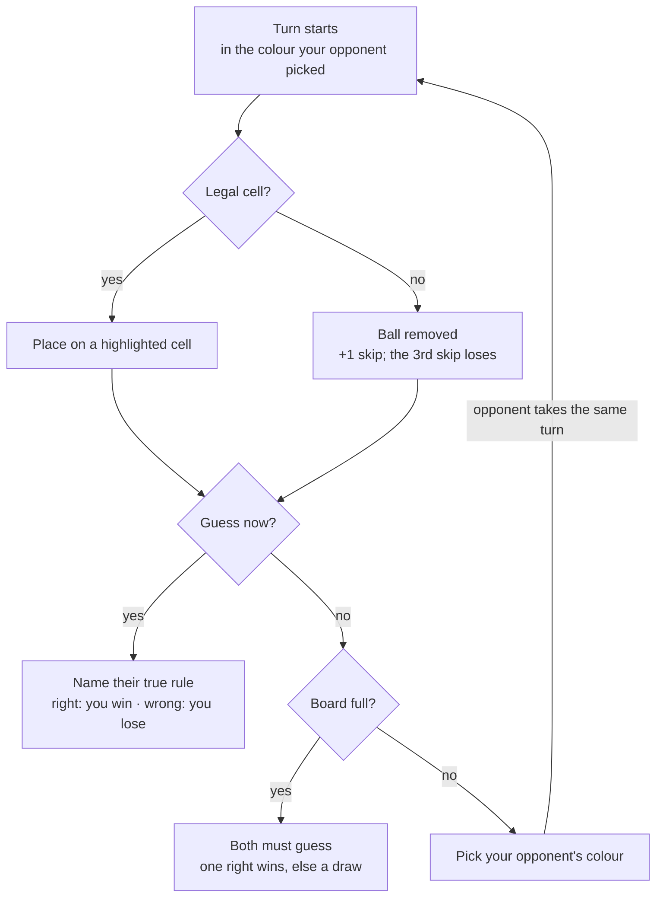

# Ballen — Game Design Document

Oct 25, 2026 · Cezary Troska

> Exported from the online design doc. When the design changes, update this file (or re-export) so the repo copy stays the reference for code.

## About this template

This GDD follows Scott Rogers' "Ten-Pager" from *Level Up! The Guide to Great Video Game Design*, a GDD structure commonly used in game design courses. It borrows the asset breakdown and timeline from Jason Bakker's indie GDD template. Both fit a solo or small-team project because they stay short and practical.

| Template | Structure | Why it's used here |
| --- | --- | --- |
| [Level Up! (Scott Rogers)](https://oreilly.com/library/view/level-up-the/9781118877197) | One-Sheet → Ten-Pager → Beat Chart → full GDD | Backbone: overview, core loop, progression, controls, art, USP |
| [A GDD template for the indie developer (Jason Bakker, Game Developer, 2009)](https://www.gamedeveloper.com/design/a-gdd-template-for-the-indie-developer) | 10 sections: intro, gameplay, art style, systems, assets, game flow, timeline, ideas | Asset lists, game-flow diagram, project timeline |

**How to use it:** keep it a living document. Fill the *Open questions* first, then update sections as the prototype changes. Aim for about 10 pages; detail belongs in the code and in a per-rule spec.

## 1. Game overview

Ballen is a two-player bluffing and deduction game on a 6 × 6 board. Each player hides one true rule among four fakes, places balls to bluff, and wins by naming which of the opponent's rules is real. Anything marked *Open question* still needs a decision.

| Field | Current answer |
| --- | --- |
| Title | Ballen |
| Elevator pitch | Hide your one true rule among four fakes, bluff with every ball you place, and win by naming your opponent's real rule first. |
| Genre | Two-player bluffing and deduction / abstract strategy |
| Players | 1 player vs. AI (Easy, Normal, Hard) at launch; online matchmaking in a later release |
| Platform | Browser first (web build, e.g. on itch.io), then mobile (Android, iOS). Mouse and touch. |
| Engine | Godot 4.7, GDScript |
| Target audience | *Open question: e.g. fans of deduction games like Cryptid and Zendo, mobile puzzle players.* |
| Match length | *Open question: target minutes per match.* |
| Unique selling point | Rules hidden in plain sight: you see all 5 of your opponent's rules and race to work out which one is real, while your own true rule limits what you can do. |

## 2. Gameplay & mechanics

A match is a duel of hidden rules. Each player's one true rule decides where they may place; their four fakes exist only to mislead. You win by naming your opponent's true rule, or when they skip 3 times.



Hiding is the obvious strategy: placing only where all 5 of your rules hold reveals nothing. The colour pick is the counter: every colour you hand your opponent is a probe that can force a fake rule to break, or force a skip.

| Element | How it works |
| --- | --- |
| Setup | Each player brings a saved deck of 5 rules and secretly marks 1 as true for this match. The opponent sees all 5, not which one is true. |
| Board | 6 × 6 grid shared by both players. Rules look at the whole board, both players' balls included. |
| Balls | 4 colours: yellow, blue, red, green. Your opponent picks the colour you place next; the match's first ball is random. |
| Placing | Cells legal under your true rule are highlighted, and you must place if any is legal. Fake rules are never enforced. A drop on any other cell snaps back, unseen by the opponent. |
| Skip | No legal cell for that colour: the game removes the ball automatically. 3 skips in total and you lose. |
| Guess | After placing or skipping, you may name your opponent's true rule. Right wins, wrong loses (may become 2 wrong guesses after playtesting). |
| Full board | Both players must guess. Exactly one right wins; both right or both wrong is a draw. |
| Notes | Mark opponent rules ✗ ruled out or ? suspect. Private, never checked by the game. |
| History | Step back through every past board state, with each turn's ball or skipped colour highlighted. |

**Open questions**

- [ ] Who takes the first turn, and does going first need balancing?
- [ ] Ratio of true to fake rules: keep 1 / 4, or try 2 / 6? (playtest)
- [ ] Wrong guesses before losing: 1 or 2? (playtest)
- [ ] Does the colour pick need limits, e.g. not the same colour twice in a row? (playtest)
- [ ] With 2 true rules, must a guess name both?
- [ ] Turn time limit for online play?

## 3. Progression & content

The rules library is Ballen's main content. Every rule is plain data assembled from shared parts, so a new rule needs no code, and a new mechanic is one new part that leaves existing rules untouched.

**How a rule is built**

| Part | Answers | Examples |
| --- | --- | --- |
| Selector | Which cells or balls to look at? | Neighbours (4 or 8), row, column, diagonals, whole board, your last ball, opponent's last ball |
| Filter | Which of those count? | Same colour as this ball, a fixed colour, mine / opponent's, empty / occupied |
| Condition | What must be true? | Count = 0, ≤ N, ≥ N, more A than B, exists / none |
| Combiner | How do conditions join? | AND, OR, NOT, IF … THEN |
| Context | What a rule may know | Board, target cell, ball colour, ball owner, move history, turn number, skips |

A rule is a **template plus the values in its blanks**. The template holds the hand-written text ("Ball can't be placed in the same \_\_\_ as \_\_\_") and maps to parts underneath. Built-in and player-made rules share this one JSON-ready format:

```json
{ "template": "not_same_line_as", "values": { "line": "row", "target": "same_colour" } }
```

Every rule is a pure function of the context that answers pass or fail. The same code drives the highlights, the AI and, later, the server. A rule that doesn't fit the parts gets its own script as a fallback.

**Rule ideas** (not yet checked for strictness)

| Type | Example rules |
| --- | --- |
| Colour & neighbours | Never next to the same colour; red only touching blue |
| Position | Only on even rows; never on the edge |
| Counts | At most 2 of a colour in any row; never more red than blue on the board |
| Ball owner | Never next to an opponent ball |
| History | Not next to the ball you placed last; never the same row as your previous ball |
| Geometry | Never complete a line of 3; at least 2 cells from any red |
| Connection | Must touch an existing ball; must join your own group |
| Relative position | Above your last ball; closer to the opponent's side than your last ball |
| Colour order | Must touch the next colour in yellow → blue → red → green |
| Space | Only cells with 2+ empty neighbours; never fill a row completely |
| Time | On odd turns, edge only; for the first 5 turns, your own half only |
| Game state | After any skip, must touch one of your own balls |
| Opponent-aware | Never next to the opponent's last ball |

**Decks and player-made rules**

- A deck is 5 rules, saved and reused; the true rule is chosen at the start of each match.
- All built-in rules are available at launch; unlocking rules may become the progression system later.
- Player-made rules come in a later release: fill-in-the-blank templates with dropdowns. A strictness check tests each new rule on many random boards and accepts it only if it forbids roughly 20–60% of placements (thresholds set in playtesting).

**Open questions**

- [ ] How many built-in rules does the first release need?
- [ ] Deck limits: can a deck hold two near-identical rules? Are some rules too strong as the true rule?
- [ ] Progression: what do players earn (rules, cosmetics, ranks)?
- [ ] Modes beyond single matches vs. AI, e.g. a puzzle campaign?

## 4. Story, setting & tone

Ballen is currently an abstract game with no story, which is normal for the genre. Decide early whether it stays that way, because the answer shapes art and audio.

- [ ] Pure abstract, or a light theme (e.g. a character, a world, a framing device)?
- [ ] Tone in three words (e.g. calm, clever, playful)

## 5. Interface & controls

Ballen is played by drag and drop with mouse or touch. On your turn the cells your true rule allows are highlighted, so nobody has to work out legality in their head; a drop anywhere else snaps the ball back.

| Screen | Contents | Status |
| --- | --- | --- |
| Main menu | Single Player, Quit; later Online and Deck builder | Built (`gui/menus/main_menu.tscn`) |
| Deck builder | Choose 5 rules from the library and save decks; later the template editor for player-made rules | Not started |
| Match setup | Pick a deck, mark its true rule, choose AI level (Easy, Normal, Hard) | Not started |
| Game screen | Board, your ball, colour picker for the opponent's next ball, both rule lists, skip counters, Guess button | In progress (`main_game.tscn`, `gui/rules_box.tscn`) |
| Notes | Tap an opponent rule to cycle ✗ ruled out / ? suspect / no mark | Not started |
| History | Step back and forward through board states; each turn's ball or skipped colour highlighted | Not started |
| Pause / settings | *Open question* | Not started |
| Match end | Win, lose or draw. *Open question: reveal both true rules, rematch button?* | Not started |

**Layout:** portrait window, 512 × 704 px, which suits both phones and the browser. The 6 × 6 board sits between the opponent's area at the top and yours at the bottom.

- [ ] Where do both rule lists, notes and history fit on a phone screen?
- [ ] Feedback for placing, skipping and guessing (animation, sound)?
- [ ] How does the opponent see that you skipped, and which colour it was?

## 6. Art & audio

Art uses Kenney assets for now, with one ball sprite tinted at runtime to yellow, blue, red or green. Audio has not been started.

| Asset group | Needed | Status |
| --- | --- | --- |
| Balls | One sprite, 4 colour tints | Done (Kenney + `Constants.colors`) |
| Board | Tile set for the grid | In use (Kenney) |
| UI / menus | Buttons, rule cards, fonts | Partly done |
| Effects | Legal-cell highlight; place, skip, guess and win feedback | Not started |
| Sound effects | Pick up, place, skip, guess, turn change | Not started |
| Music | Menu and in-game tracks | Not started |

- [ ] Keep the Kenney look, or move to custom art later?
- [ ] Colour-blind support: add a shape or pattern per ball colour?

## 7. Technical overview

Ballen runs on Godot 4.7 with the GL Compatibility renderer and statically typed GDScript, which exports to the browser first and to Android and iOS later. Game logic is kept apart from the scenes, so the AI, the highlights and a future server all run the same code.

| Layer | Holds | Notes |
| --- | --- | --- |
| Game model | Board, turn order, colour picks, skips, guesses, move history | Plain GDScript classes, no scene nodes |
| Rules engine | Templates, parts (selectors, filters, conditions, combiners), evaluation | Pure functions over a placement context; rules loaded from JSON-ready data |
| AI | Rule choice, placement, colour picks, deduction, guessing | Sees only public information; Easy, Normal, Hard |
| Scenes / UI | Board (`gui/balls_board.gd`), ball drag (`gui/ball.gd`), rules box, menus | Show the model and send player actions; never decide legality themselves |
| Autoloads | `EventBus` (global signals), `Constants` (colour table), `Utils` (turn state) | `Utils.player_turn` moves into the game model |
| Online (later) | Both true rules; checks every move | Clients never receive the opponent's true rule |

**Key technical decisions:** `valid_placement()` in `gui/ball.gd` asks the game model instead of checking rules itself. The existing `rules/baserule.gd` (`class_name Rule`) becomes the base of the parts system and the custom-script fallback. The AI deduces fairly: a rule stays a candidate only while every past placement and skip is consistent with it.

## 8. Production

The next milestone is a playable prototype: one full match against a simple AI, with rules built from parts. Dates are not set yet; add them when you know your weekly time budget.

1. **Prototype** — game model and rules engine, a handful of rules, highlights, colour picks, skips, guessing, a simple AI, match result
2. **Rules & decks** — a larger rule library, deck builder and match setup screens
3. **AI levels** — Easy, Normal, Hard, each deducing and bluffing fairly
4. **Vertical slice** — notes, history, feedback effects, sound, match-end screen
5. **Browser release** — web build for playtesting (e.g. itch.io); tune rule ratio, wrong guesses and colour picks
6. **Mobile release** — Android and iOS builds, touch polish
7. **Later** — online matchmaking, player-made rules, rule unlocks

**Out of scope for the first release:** online multiplayer and player-made rules (both planned later), story, monetisation. *Open question: confirm story and monetisation.*
